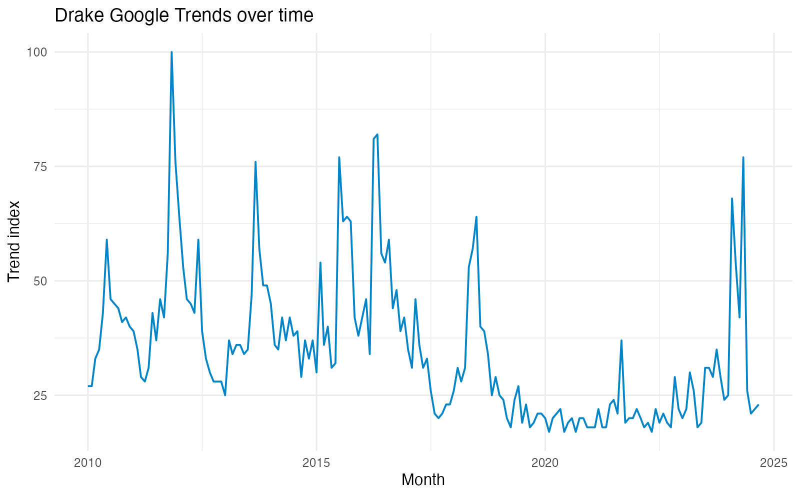
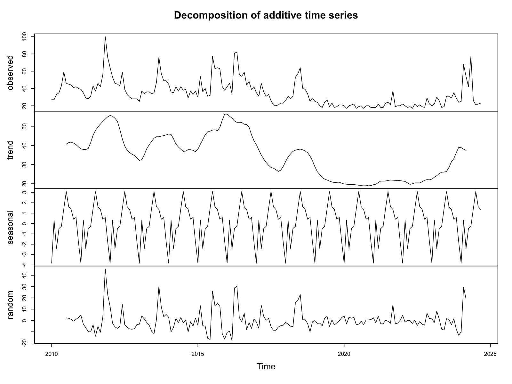
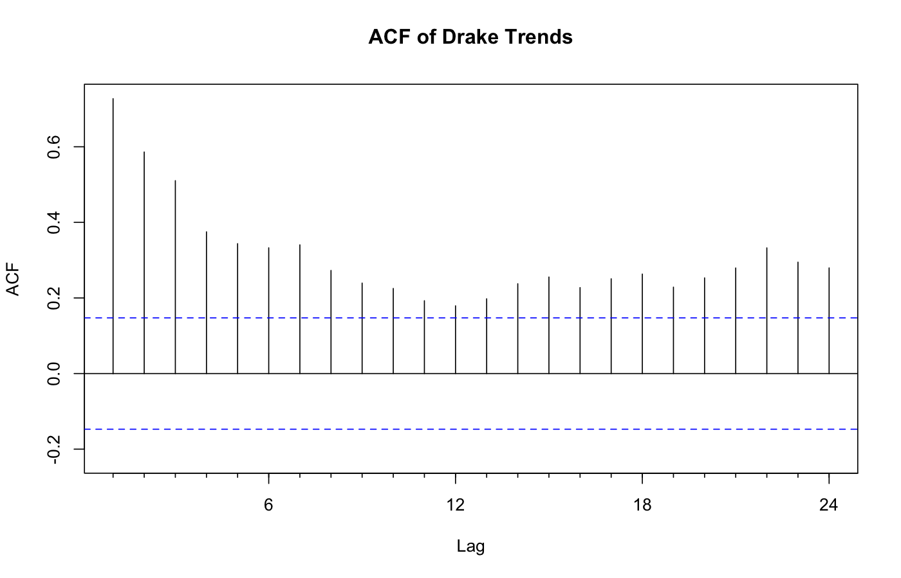
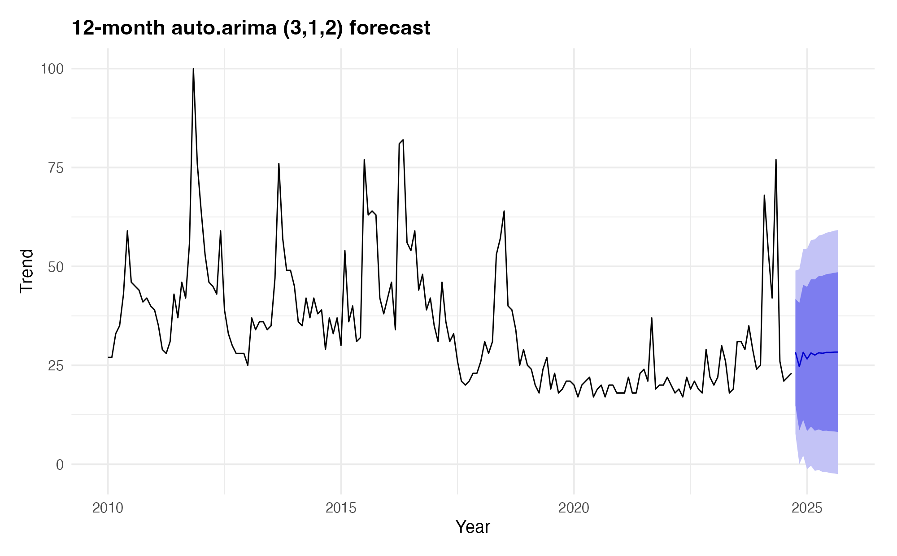
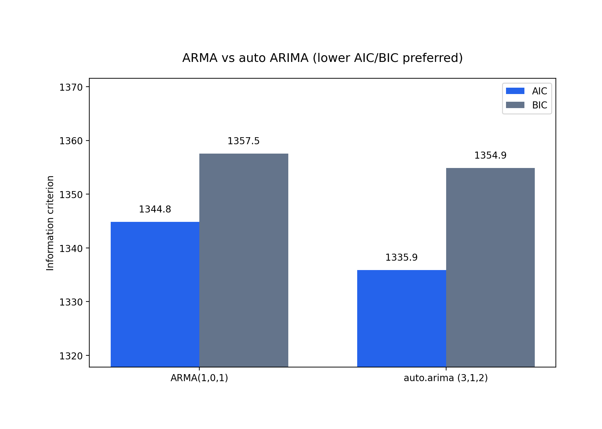

# Drake Popularity Time Series Analysis (2010–2024)

This project analyzes Google Trends data for the artist Drake from 2010 to 2024 using time series methods in R.

## Methods Used
- Time Series Visualization
- Decomposition (Trend + Seasonality)
- Augmented Dickey-Fuller Test
- ACF & PACF Analysis
- ARMA Modeling
- Forecasting (Next 12 Months)
- Spectral Analysis

## Tools
- R
- forecast
- ggplot2
- tseries
- tidyverse

## Key Findings
- Popularity peaks align with album releases and public events.
- Seasonal patterns repeat yearly.
- ARMA(1,1) model used for forecasting.

## Screenshots

### Trend series

Drake Google Trends interest from 2010 onward.

### Decomposition

Additive trend, seasonal, and remainder components.

### ACF

Autocorrelation structure used to guide ARMA orders.

### Forecast

12-month forecast from auto.arima ARIMA(3,1,2), the lower-AIC/BIC model.

### ARMA vs ARIMA

AIC and BIC for the hand-specified ARMA(1,0,1) vs auto.arima ARIMA(3,1,2).

